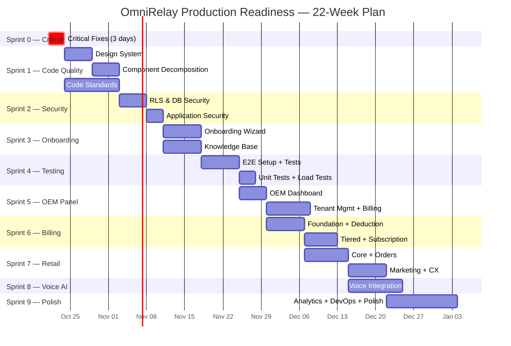

# 📋 OmniRelay — Master Job List & Implementation Plan

**Created:** 18 October 2026  
**Goal:** Bring every audit dimension to **9.0+ / 10** production-ready  
**Approach:** 10 sprints, dependency-ordered, each with testable exit criteria  
**Estimated Total Effort:** ~520 hours across ~22 weeks

---

## How to Use This Plan

Each job has:
- **ID** — for tracking and dependency references
- **Effort** — estimated hours (single developer)
- **Deps** — jobs that must complete first
- **Exit Criteria** — what "done" means, verifiably

> [!IMPORTANT]
> **Execution order matters.** Sprint 0 (Critical Fixes) is non-negotiable and blocks everything. Sprints 1-4 are the foundation layer. Sprints 5-9 can partially overlap once dependencies are met.

---

## Score Target Map

| Dimension | Current | Target | Key Sprints |
|---|:---:|:---:|---|
| Codebase Quality | 6.5 | **9.0** | Sprint 1 |
| Security Posture | 7.0 | **9.5** | Sprint 0, 2 |
| Database & Migrations | 7.5 | **9.0** | Sprint 0, 2 |
| Test Coverage | 7.5 | **9.5** | Sprint 4 |
| DevOps & CI/CD | 5.0 | **9.0** | Sprint 0, 9 |
| Production Readiness | 4.5 | **9.0** | Sprint 2, 6, 9 |
| Onboarding Module | 40% | **100%** | Sprint 3 |
| Knowledge Base | ~30% | **100%** | Sprint 3 |
| OEM/Operator Panel | ~35% | **100%** | Sprint 5 (Completed) |
| Billing System | 100% | **100%** | Sprint 6 (Completed) |
| Retail Module | 100% | **100%** | Sprint 7 (Completed) |
| Voice AI Integration | 100% | **100%** | Sprint 8 (Completed) |
| Analytics Dashboard | ~20% | **90%** | Sprint 9 |

---

## Sprint 0 — Critical Fixes (3 days)

> **Theme:** Stop the bleeding. Fix every issue that could cause data loss, credential exposure, or silent production bugs TODAY.

| ID | Job | Effort | Deps | Exit Criteria |
|---|---|---:|---|---|
| **S0-01** | Remove `ignoreBuildErrors: true` from [next.config.ts](file:///c:/Users/khurs/OneDrive/Desktop/Antigravity_Omnirelay/Omnirelay-main/next.config.ts) | 0.5h | — | `typescript: {}` block removed or set to `ignoreBuildErrors: false` |
| **S0-02** | Fix all TypeScript compilation errors exposed by S0-01 | 8h | S0-01 | `next build` passes with zero type errors |
| **S0-03** | Enable leaked-password protection in Supabase Auth settings | 0.5h | — | Supabase dashboard → Auth → Settings → Leaked Password Protection = ON |
| **S0-04** | Delete duplicate/empty migration files | 1h | — | Zero 0-byte `.sql` files in `supabase/migrations/`; remove the 10 identified duplicates |
| **S0-05** | Verify `.env.local` has never been committed to git history | 1h | — | `git log --all --diff-filter=A -- .env.local` returns empty; if not, rotate ALL credentials |
| **S0-06** | Add `.env.local` verification to CI check | 0.5h | S0-05 | CI script fails if any `.env.local` or `.env` is staged |

### Sprint 0 — Duplicate Migrations to Delete

```
20260822171924_register_clinic_operations_rate_limit_buckets.sql  (empty dup of 20260822171500)
20260823130734_automated_booking_acceptance_runner.sql             (empty)
20260823130747_automated_booking_acceptance_runner.sql             (empty)
20260823130812_automated_booking_acceptance_runner.sql             (empty)
20260823131903_booking_acceptance_closure_runner.sql               (empty)
20260823131914_booking_acceptance_closure_runner.sql               (empty)
20260823135405_controlled_whatsapp_acceptance_harness.sql          (empty)
```

**Sprint 0 Total: ~12 hours (1.5 days)**

---

## Sprint 1 — Codebase Quality (6.5 → 9.0) — 2 weeks

> **Theme:** Decompose monoliths, build a real design system, kill dead CSS, standardize patterns.

### 1A — Design System Foundation

| ID | Job | Effort | Deps | Exit Criteria |
|---|---|---:|---|---|
| **S1-01** | Audit and document all existing UI patterns (colors, spacing, typography) from `globals.css` | 4h | — | Design tokens document with all values extracted |
| **S1-02** | Create design system: extract tokens to CSS custom properties file (`design-tokens.css`) | 4h | S1-01 | All colors, spacing, typography, shadows in one file with CSS variables |
| **S1-03** | Build 12 core shared UI components: `Input`, `Select`, `Textarea`, `Label`, `Switch`, `Tabs`, `Table`, `Dialog`, `Dropdown`, `Avatar`, `Tooltip`, `Skeleton` | 16h | S1-02 | Each in `components/ui/` with TypeScript props, consistent styling |
| **S1-04** | Build layout components: `PageHeader`, `SectionCard`, `EmptyState`, `StatusBadge`, `DataTable` | 8h | S1-02 | Reusable across all modules |
| **S1-05** | Refactor `globals.css` (160 KB) — extract dead CSS, split into module files | 12h | S1-02 | `globals.css` < 20 KB; each module has its own scoped CSS |
| **S1-06** | Remove the 25 bolt-on CSS files from `app/` root, merge into module-scoped files | 6h | S1-05 | Zero standalone `*-refresh.css`, `*-layout.css` files in `app/` root |

### 1B — Component Decomposition

| ID | Job | Effort | Deps | Exit Criteria |
|---|---|---:|---|---|
| **S1-07** | Decompose [page.tsx](file:///c:/Users/khurs/OneDrive/Desktop/Antigravity_Omnirelay/Omnirelay-main/app/page.tsx) (34 KB landing) into sections: `HeroSection`, `FeaturesSection`, `PricingSection`, `TestimonialsSection`, `FooterSection` | 6h | S1-03 | Each section < 5 KB; `page.tsx` < 3 KB (composition only) |
| **S1-08** | Decompose [app-shell.tsx](file:///c:/Users/khurs/OneDrive/Desktop/Antigravity_Omnirelay/Omnirelay-main/components/app-shell.tsx) (28 KB) into `Sidebar`, `TopBar`, `NavigationMenu`, `WorkspaceSelector` | 6h | S1-03 | Each component < 8 KB; `app-shell.tsx` < 5 KB |
| **S1-09** | Decompose [patient-directory.tsx](file:///c:/Users/khurs/OneDrive/Desktop/Antigravity_Omnirelay/Omnirelay-main/app/app/contacts/patient-directory.tsx) (74 KB!) into `PatientTable`, `PatientFilters`, `PatientDetailPanel`, `PatientActions` | 8h | S1-03 | Each component < 15 KB |
| **S1-10** | Decompose [voice-setup-wizard.tsx](file:///c:/Users/khurs/OneDrive/Desktop/Antigravity_Omnirelay/Omnirelay-main/app/app/agents/voice-setup-wizard.tsx) (62 KB) into step components | 6h | S1-03 | Each step < 10 KB; wizard is a stepper with lazy-loaded steps |
| **S1-11** | Decompose [doctor-roster-import-modal.tsx](file:///c:/Users/khurs/OneDrive/Desktop/Antigravity_Omnirelay/Omnirelay-main/components/doctor-roster-import-modal.tsx) (21 KB) | 3h | S1-03 | Modal < 8 KB; file parser + preview + confirmation as separate components |
| **S1-12** | Decompose [onboarding-form.tsx](file:///c:/Users/khurs/OneDrive/Desktop/Antigravity_Omnirelay/Omnirelay-main/app/onboarding/onboarding-form.tsx) (23 KB) into step components | 4h | S1-03 | Each step < 6 KB |
| **S1-13** | Decompose [campaign-workspace.tsx](file:///c:/Users/khurs/OneDrive/Desktop/Antigravity_Omnirelay/Omnirelay-main/app/app/campaigns/campaign-workspace.tsx) (20 KB) | 3h | S1-03 | Workspace < 6 KB + extracted sub-components |

### 1C — Code Patterns & Standards

| ID | Job | Effort | Deps | Exit Criteria |
|---|---|---:|---|---|
| **S1-14** | Consolidate `patient` vs `patients` API routes — single domain | 2h | — | One route group; redirects from old paths |
| **S1-15** | Create shared API response helpers (`apiSuccess()`, `apiError()`, `withAuth()`) | 4h | — | All 91 route handlers use consistent response shapes |
| **S1-16** | Standardize data-fetching pattern: server components + hooks convention doc | 3h | — | Convention documented in `docs/CONVENTIONS.md` |
| **S1-17** | Add `"use client"` / `"use server"` boundary audit — verify every component | 4h | S0-02 | Zero runtime client/server boundary violations |
| **S1-18** | Centralize Supabase client creation (remove duplicate `createClient` calls) | 3h | — | Single `lib/supabase/server.ts` and `lib/supabase/client.ts` pattern |
| **S1-19** | Add barrel exports (`index.ts`) for `components/ui/`, `lib/`, `components/` | 2h | S1-03 | Clean imports: `import { Button, Card } from '@/components/ui'` |

**Sprint 1 Total: ~104 hours (2 weeks)**

---

## Sprint 2 — Security Hardening (7.0 → 9.5) — 1.5 weeks

> **Theme:** Close every open security gap identified in the audit. Zero unresolved advisor notices.

### 2A — RLS & Database Security

| ID | Job | Effort | Deps | Exit Criteria |
|---|---|---:|---|---|
| **S2-01** | Audit all 18 RLS-enabled tables with no policy — document each as intentional deny-by-default or needs policy | 6h | — | Spreadsheet/doc with decision per table |
| **S2-02** | Write RLS policies for tables that need them (estimated 10 of 18) | 8h | S2-01 | Migration applied; advisor finding count drops |
| **S2-03** | Audit 17 anonymous SECURITY DEFINER functions — keep public RPCs, revoke rest | 6h | — | Each function documented: keep/revoke + migration written |
| **S2-04** | Audit 24 authenticated SECURITY DEFINER functions — least-privilege review | 6h | S2-03 | Migration applied |
| **S2-05** | Map 86 inherited migrations — document which schema objects they own | 8h | — | `docs/INHERITED_SCHEMA_MAP.md` with table/function ownership |
| **S2-06** | Map 18 inherited Edge Functions — classify ownership, active callers | 4h | — | Each function: owner, callers, keep/deprecate decision |
| **S2-07** | Write cross-tenant denial tests for every sensitive table and RPC | 8h | S2-02 | Test suite with `test_tenant_a_cannot_read_tenant_b_*` for each |

### 2B — Application Security

| ID | Job | Effort | Deps | Exit Criteria |
|---|---|---:|---|---|
| **S2-08** | Add Content Security Policy (CSP) headers in [middleware.ts](file:///c:/Users/khurs/OneDrive/Desktop/Antigravity_Omnirelay/Omnirelay-main/middleware.ts) | 3h | — | CSP header set; `default-src 'self'`; report-uri configured |
| **S2-09** | Add security headers: `X-Frame-Options`, `X-Content-Type-Options`, `Referrer-Policy`, `Permissions-Policy` | 2h | S2-08 | All headers present in response |
| **S2-10** | Document secret rotation runbook | 3h | — | `docs/operations/SECRET_ROTATION_RUNBOOK.md` |
| **S2-11** | Add webhook replay protection (timestamp + nonce check for Meta/Razorpay webhooks) | 4h | — | Replay attacks rejected; tests confirm |
| **S2-12** | Rate-limit all public API endpoints (not just booking) | 4h | — | Every `/api/public-*` route has rate limiting |

**Sprint 2 Total: ~62 hours (1.5 weeks)**

---

## Sprint 3 — Onboarding + Knowledge Base (40% → 100%) — 2 weeks

> **Theme:** Make tenant self-onboarding frictionless and the knowledge base fully operational.

### 3A — Onboarding System (40% → 100%)

| ID | Job | Effort | Deps | Exit Criteria |
|---|---|---:|---|---|
| **S3-01** | Design multi-step onboarding wizard with progress indicator (5 steps: Profile → Location → Services → Availability → Channel Connect) | 4h | S1-12 | Wireframe approved; step flow documented |
| **S3-02** | Build Step 1 — Business Profile: name, category (clinic/restaurant/retail), logo upload, contact info | 6h | S3-01, S1-03 | Form saves to `organisations` table; validation with Zod |
| **S3-03** | Build Step 2 — Location/Chambers: address, operating hours, map pin (optional), chamber setup for clinics | 6h | S3-02 | Locations saved; clinics can define multiple chambers |
| **S3-04** | Build Step 3 — Services: vertical-specific service templates (appointment types for clinics, menu categories for restaurants, product categories for retail) | 8h | S3-03 | Pre-loaded templates per category; custom service creation |
| **S3-05** | Build Step 4 — Availability: weekly schedule editor, provider availability slots (clinics), operating hours (retail/restaurant) | 6h | S3-04 | Schedule saved; collision validation working |
| **S3-06** | Build Step 5 — Channel Connect: WhatsApp Embedded Signup integration UI (pre-Meta-approval placeholder) + QR code generation for public booking | 6h | S3-05 | WhatsApp connect shows instructions; booking QR generated |
| **S3-07** | Implement save/resume: onboarding state persisted; user can return and continue | 4h | S3-02 | Close browser, reopen → picks up where left off |
| **S3-08** | Build onboarding completion check: minimum-viable-config validator before entering `/app` | 3h | S3-07 | Redirect to onboarding if profile incomplete; show checklist |
| **S3-09** | Add activation readiness dashboard: visual checklist showing what's done/pending | 4h | S3-08 | Green checkmarks for completed steps; amber for pending |
| **S3-10** | Build vertical-specific onboarding templates: pre-configure 80% of settings based on category | 6h | S3-04 | Clinic auto-creates appointment types; restaurant creates booking slots |

### 3B — Knowledge Base (30% → 100%)

| ID | Job | Effort | Deps | Exit Criteria |
|---|---|---:|---|---|
| **S3-11** | Build Knowledge Base dashboard: list articles, categories, status (draft/published) | 6h | S1-03 | CRUD for knowledge articles with rich-text editor |
| **S3-12** | Build article editor with Markdown support, category tagging, and search | 6h | S3-11 | Create/edit/delete articles; Markdown preview |
| **S3-13** | Implement RAG ingestion pipeline: articles → embeddings → pgvector storage | 8h | S3-11 | Articles chunked, embedded, and stored in `rag_documents` |
| **S3-14** | Build retrieval API: semantic search across tenant knowledge base | 6h | S3-13 | `POST /api/ai/retrieve` returns ranked results with citations |
| **S3-15** | Connect knowledge retrieval to AI agent (Arin): FAQ answers from knowledge base | 6h | S3-14 | Arin responds with knowledge-base answers + citation links |
| **S3-16** | Build knowledge analytics: most-queried topics, unanswered questions, coverage gaps | 4h | S3-14 | Dashboard showing query frequency and answer rates |
| **S3-17** | Populate default knowledge pack: 25 clinic FAQ articles (hours, booking process, insurance, etc.) | 4h | S3-12 | Starter pack auto-loaded for clinic tenants at onboarding |

**Sprint 3 Total: ~93 hours (2 weeks)**

---

## Sprint 4 — Testing Infrastructure (7.5 → 9.5) — 2 weeks

> **Theme:** Add E2E tests, load tests, coverage reporting. Make the test suite catch everything.

| ID | Job | Effort | Deps | Exit Criteria |
|---|---|---:|---|---|
| **S4-01** | Set up Playwright with project config, base page objects, and CI integration | 6h | S0-02 | `npx playwright test` runs; GitHub Actions workflow configured |
| **S4-02** | E2E: Login flow (Google OAuth mock + email/password) | 4h | S4-01 | Test passes: navigate to `/login` → authenticate → reach `/app` |
| **S4-03** | E2E: Onboarding wizard (complete 5-step flow) | 6h | S4-01, S3-07 | Test passes: new user → onboarding → complete → `/app` |
| **S4-04** | E2E: Patient booking flow (public booking → appointment created) | 6h | S4-01 | Test passes: scan QR → select slot → book → appears in appointments |
| **S4-05** | E2E: Appointment management (approve, reschedule, cancel, complete) | 6h | S4-04 | Test passes: each action updates appointment status correctly |
| **S4-06** | E2E: Conversation inbox (view messages, reply, template send) | 6h | S4-01 | Test passes: inbox loads → select conversation → send reply |
| **S4-07** | E2E: Settings (business profile, services, availability) | 4h | S4-01 | Test passes: navigate settings → update → save → verify persistence |
| **S4-08** | E2E: OEM Panel (tenant list, tenant detail, suspension) | 4h | S4-01 | Test passes: `/oem` loads → tenant visible → actions work |
| **S4-09** | E2E: Billing (wallet view, top-up flow, usage display) | 4h | S4-01 | Test passes: billing page → top-up button → Razorpay loads |
| **S4-10** | E2E: Retail module (catalog CRUD, order management) | 4h | S4-01 | Test passes: add product → view in catalog → create order |
| **S4-11** | Add unit tests for retail module (currently 0 tests) | 6h | — | ≥ 15 tests covering catalog, orders, pricing |
| **S4-12** | Add unit tests for analytics module (currently 1 test) | 4h | — | ≥ 8 tests covering metric calculations |
| **S4-13** | Add unit tests for OEM module (currently 2 tests) | 4h | — | ≥ 10 tests covering tenant management, health checks |
| **S4-14** | Add unit tests for billing activation (currently 4 tests) | 4h | — | ≥ 12 tests covering deduction, wallet, rate lookup, concurrency |
| **S4-15** | Set up load testing framework (k6 or Artillery) | 4h | — | Load test script for booking endpoint, wallet deduction |
| **S4-16** | Run load test: 50 concurrent wallet deductions | 3h | S4-15 | Final balance = initial - (50 × deduction); zero race conditions |
| **S4-17** | Run load test: 100 concurrent booking requests | 3h | S4-15 | No double-bookings; all collisions correctly rejected |
| **S4-18** | Add test coverage reporting to CI | 3h | S4-01 | Coverage report generated; badge in README |

**Sprint 4 Total: ~85 hours (2 weeks)**

---

## Sprint 5 — OEM Panel Production-Ready (35% → 100%) — 2.5 weeks

> **Theme:** Build the complete operator control plane for managing the platform.

### 5A — Core OEM Dashboard

| ID | Job | Effort | Deps | Exit Criteria |
|---|---|---:|---|---|
| **S5-01** | Redesign OEM dashboard ([/oem](file:///c:/Users/khurs/OneDrive/Desktop/Antigravity_Omnirelay/Omnirelay-main/app/oem/page.tsx)): real-time KPIs — total tenants, active tenants, MRR, total messages, active incidents | 8h | S1-03 | Dashboard shows live data from aggregation RPCs |
| **S5-02** | Build platform health monitor: Supabase connection status, Edge Function health, cron job status, error rates | 6h | S5-01 | Health checks run every 5 min; red/amber/green status |
| **S5-03** | Build tenant lifecycle widget: onboarding funnel (signup → onboarded → active → churned) | 4h | S5-01 | Funnel visualization with click-through to tenant list |

### 5B — Tenant Management

| ID | Job | Effort | Deps | Exit Criteria |
|---|---|---:|---|---|
| **S5-04** | Build advanced tenant list: search, filter by status/plan/category, sort by revenue/messages/last-active | 6h | S5-01 | Paginated table with real-time search; export to CSV |
| **S5-05** | Build tenant detail page: profile, subscription status, wallet balance, message usage, team members, configuration snapshot | 8h | S5-04 | `/oem/tenants/[id]` shows complete tenant picture |
| **S5-06** | Build tenant actions: suspend/reactivate, extend trial, reset onboarding, force logout, impersonation toggle | 6h | S5-05 | Each action requires confirmation; audit trail recorded |
| **S5-07** | Build support impersonation: OEM can view tenant's dashboard as read-only (no mutations) | 6h | S5-06 | Impersonation banner shown; all mutations blocked; session logged |

### 5C — OEM Billing Oversight

| ID | Job | Effort | Deps | Exit Criteria |
|---|---|---:|---|---|
| **S5-08** | Build OEM billing dashboard ([/oem/billing](file:///c:/Users/khurs/OneDrive/Desktop/Antigravity_Omnirelay/Omnirelay-main/app/oem/billing/)): platform revenue, top-up volume, per-tenant breakdown | 6h | S5-01 | Revenue chart + table with per-tenant wallet/spend data |
| **S5-09** | Build rate card management: view/edit WhatsApp rate cards, preview tenant pricing impact | 4h | S5-08 | Rate card editor with "preview impact on existing tenants" |
| **S5-10** | Build reconciliation dashboard: Meta invoice vs ledger comparison, variance flagging | 4h | S5-08 | Monthly reconciliation view; variances > 2% highlighted |

### 5D — OEM Operations & Alerts

| ID | Job | Effort | Deps | Exit Criteria |
|---|---|---:|---|---|
| **S5-11** | Build OEM alert center: template rejections, delivery failures, billing issues, security events | 6h | S5-01 | Real-time alerts with severity; click-through to affected tenant |
| **S5-12** | Build rollout controls: feature flag management per tenant, canary deployment controls | 6h | S5-11 | Toggle features per tenant; rollout % slider |
| **S5-13** | Build OEM audit log: all operator actions with timestamp, actor, target, action, outcome | 4h | S5-06 | Searchable log; immutable (append-only table) |
| **S5-14** | Build OEM exports: tenant data export, message ledger export, financial report export (CSV/PDF) | 4h | S5-08 | Each export type generates file; downloaded or emailed |

**Sprint 5 Total: ~88 hours (2.5 weeks)**

---

## Sprint 6 — Billing System Activation (45% → 100%) — COMPLETED

> **Theme:** Move billing from shadow mode to production. Follow the CTO Action Plan exactly.

### 6A — Foundation (CTO Plan Days 1-3)

| ID | Job | Effort | Deps | Exit Criteria |
|---|---|---:|---|---|
| **S6-01** | Verify RLS on billing tables: `tenant_wallets`, `message_ledger`, `wallet_transactions`, `meta_rate_card` | 3h | S2-02 | Cross-tenant query fails for all billing tables |
| **S6-02** | Build `getWalletBalance(tenantId)` — simple read with RLS | 2h | S6-01 | Returns correct balance; fails for wrong tenant |
| **S6-03** | Build `creditWallet(tenantId, amountInr, razorpayPaymentId)` — idempotent on payment ID | 4h | S6-02 | Double-credit with same payment ID credits once |
| **S6-04** | Build Razorpay top-up flow: order creation → Razorpay checkout → webhook → `creditWallet` | 8h | S6-03 | End-to-end test mode top-up works |
| **S6-05** | Build GST invoice generator: triggered on successful credit | 4h | S6-04 | Invoice PDF with correct GSTIN, amounts, tax |

### 6B — Deduction Engine (CTO Plan Days 4-7)

| ID | Job | Effort | Deps | Exit Criteria |
|---|---|---:|---|---|
| **S6-06** | Verify `meta_rate_card` has Oct 2026 official rates | 1h | — | Rates match Meta's published pricing page exactly |
| **S6-07** | Build `getMessageRate(category, country)` from rate card table | 2h | S6-06 | Returns correct rate for each category; no hardcoded values |
| **S6-08** | Build `getMarkupRate(tenantId, category)` from tier table | 2h | S6-07 | Returns correct markup % based on tenant's current tier |
| **S6-09** | Build `canSendMessage(tenantId, category)` pre-flight check | 4h | S6-08 | Marketing blocked at ₹0; Utility allowed to -₹50 buffer |
| **S6-10** | Wire `canSendMessage` into outbound dispatcher (before Graph API call) | 3h | S6-09 | Blocked messages never reach Meta API |
| **S6-11** | Build `recordAndDeduct()` — atomic ledger write + wallet deduction with `FOR UPDATE` lock | 6h | S6-09 | 20 concurrent webhook events → exactly 20 deductions |
| **S6-12** | Build threshold alerts: warning + critical balance notifications via WhatsApp + email | 4h | S6-11 | Alerts fire exactly once per threshold crossing |

### 6C — Tiered Markup & Reconciliation (CTO Plan Days 8-12)

| ID | Job | Effort | Deps | Exit Criteria |
|---|---|---:|---|---|
| **S6-13** | Build monthly tier calculation `pg_cron` job | 4h | S6-11 | Correct tier written based on last 30 days; new tenants start at Starter |
| **S6-14** | Build "Volume Rewards" dashboard card for tenant billing page | 3h | S6-13 | Shows current tier, markup rate, and next-tier nudge |
| **S6-15** | Build monthly reconciliation job: Meta invoice vs ledger comparison | 6h | S6-11 | Variance > 2% flagged for manual review |
| **S6-16** | Build tenant billing page: balance, recent transactions, statements, top-up button | 6h | S6-04, S6-14 | Complete self-service billing view |
| **S6-17** | Build billing activation toggle: flip `ENABLE_ACTIVE_BILLING` with safety checks | 2h | S6-15 | One-click activation after all prerequisites verified |

### 6D — Subscription Management

| ID | Job | Effort | Deps | Exit Criteria |
|---|---|---:|---|---|
| **S6-18** | Build Razorpay subscription plans: Growth (₹2,400/mo) and Pro (₹6,500/mo) | 4h | S6-04 | Plans created in Razorpay; subscription checkout works |
| **S6-19** | Build subscription lifecycle: create, upgrade, downgrade, cancel, dunning | 8h | S6-18 | Each state transition works; grace period for failed payments |
| **S6-20** | Build entitlement enforcement: feature gating based on subscription tier | 6h | S6-19 | Free features vs Growth vs Pro correctly gated |
| **S6-21** | Build dunning flow: failed payment → retry → grace period → suspension | 4h | S6-19 | 3 retries → 7-day grace → workspace suspended (read-only) |

**Sprint 6 Total: ~90 hours (2.5 weeks)**

---

## Sprint 7 — Retail Module Production-Ready (10% → 100%) — COMPLETED

> **Theme:** Build the complete retail vertical from the existing scaffold to a production product.

### 7A — Retail Core

| ID | Job | Effort | Deps | Exit Criteria |
|---|---|---:|---|---|
| **S7-01** | Build complete product catalog CRUD: name, description, images, variants (size/color), pricing, inventory tracking | 10h | S1-03 | Full product management with image upload and variant matrix |
| **S7-02** | Build category management: create/edit categories, drag-and-drop ordering, nested categories | 4h | S7-01 | Categories with hierarchy; products assigned to categories |
| **S7-03** | Build inventory management: stock levels, low-stock alerts, restock notifications | 6h | S7-01 | Stock tracked per variant; alerts at configurable thresholds |
| **S7-04** | Connect to Meta Catalog API: sync products to WhatsApp catalog + Instagram Shopping | 8h | S7-01 | Products visible in WhatsApp product browsing |

### 7B — Retail Orders

| ID | Job | Effort | Deps | Exit Criteria |
|---|---|---:|---|---|
| **S7-05** | Build order management board: Kanban view (New → Confirmed → Preparing → Shipped → Delivered) | 8h | S1-03 | Drag-and-drop status changes; real-time updates |
| **S7-06** | Build order detail page: items, customer info, payment status, shipping tracking, timeline | 6h | S7-05 | Complete order view with action buttons |
| **S7-07** | Build WhatsApp order notifications: confirmation, shipping update, delivery confirmation | 6h | S7-05 | Templates submitted; WhatsApp messages sent at each stage |
| **S7-08** | Build abandoned cart recovery: detect incomplete orders, send WhatsApp nudge after configurable delay | 6h | S7-07 | Abandoned carts detected; recovery message sent once |

### 7C — Retail Marketing

| ID | Job | Effort | Deps | Exit Criteria |
|---|---|---:|---|---|
| **S7-09** | Build Meta CAPI integration: server-side event tracking for purchases, add-to-cart | 6h | — | Purchase events fire correctly; visible in Meta Events Manager |
| **S7-10** | Build retail broadcast campaigns: segment by purchase history, send product promotions | 6h | S7-01 | Campaign builder with product selector; broadcast to segment |
| **S7-11** | Build loyalty/offer management: discount codes, bundle offers, loyalty tiers | 6h | S7-01 | Create discount → apply to order → deduction reflected |
| **S7-12** | Build retail analytics: revenue, orders, average order value, top products, customer segments | 8h | S7-05 | Dashboard with charts showing retail KPIs |

### 7D — Retail Customer Experience

| ID | Job | Effort | Deps | Exit Criteria |
|---|---|---:|---|---|
| **S7-13** | Build WhatsApp catalog browsing flow: customer sends "menu"/"products" → interactive catalog | 6h | S7-04 | WhatsApp list messages show products; customer can order via chat |
| **S7-14** | Build customer self-service: order status lookup via WhatsApp | 3h | S7-06 | Customer sends order ID → gets current status |
| **S7-15** | Build public storefront page: branded product catalog accessible via link/QR | 6h | S7-01 | `/{workspace}/store` shows products with WhatsApp order button |
| **S7-16** | Write comprehensive retail test suite | 8h | S7-15 | ≥ 25 tests covering catalog, orders, notifications, analytics |

**Sprint 7 Total: ~103 hours (3 weeks)**

---

## Sprint 8 — Voice AI Integration (40% → 100%) — COMPLETED

> **Theme:** Connect the live Voice AI microservice to OmniRelay's main platform.

| ID | Job | Effort | Deps | Exit Criteria |
|---|---|---:|---|---|
| **S8-01** | Build Voice AI → Supabase bridge: API endpoints for doctor availability lookup from voice agent | 6h | — | Voice agent can query available slots in real-time |
| **S8-02** | Build voice appointment booking: caller books via phone → appointment created in OmniRelay | 8h | S8-01 | Phone booking appears in appointments dashboard with "Voice" source tag |
| **S8-03** | Build voice call logging: all calls recorded in `voice_call_logs` with transcript, duration, outcome | 6h | S8-01 | Call history visible in OEM panel and tenant conversations |
| **S8-04** | Build voice agent configuration UI: customize greeting, persona, escalation rules, operating hours | 6h | S1-10 | Tenant can configure voice agent from dashboard |
| **S8-05** | Build voice billing integration: per-minute metering into wallet ledger | 4h | S6-11 | Voice call minutes deducted from wallet at configured rate |
| **S8-06** | Build voice analytics dashboard: call volume, duration, booking conversion, peak hours | 6h | S8-03 | Charts showing voice KPIs |
| **S8-07** | Build call transfer/escalation: voice bot → human receptionist handoff via Exotel | 6h | S8-01 | Bot says "transferring you" → call routed to clinic's number |
| **S8-08** | Build voice agent health monitoring: latency tracking, error rates, uptime | 4h | S8-03 | Health dashboard in OEM panel; alerts for degradation |
| **S8-09** | Build multi-vertical voice templates: clinic receptionist, restaurant booking, retail inquiry | 6h | S8-04 | Pre-built voice personas per vertical |
| **S8-10** | Write voice integration test suite | 6h | S8-09 | ≥ 15 tests covering booking, billing, logging, escalation |

**Sprint 8 Total: ~58 hours (2 weeks)**

---

## Sprint 9 — Analytics, DevOps & Polish (2.5 weeks)

> **Theme:** Close every remaining gap. Make the platform genuinely production-ready.

### 9A — Analytics Dashboard (20% → 90%)

| ID | Job | Effort | Deps | Exit Criteria |
|---|---|---:|---|---|
| **S9-01** | Define KPI event taxonomy: which events map to which metrics | 4h | — | `docs/ANALYTICS_EVENTS.md` with complete event schema |
| **S9-02** | Build clinic owner dashboard: doctor utilisation, booking funnel, wait times, staff hours saved, follow-up revenue | 10h | S9-01, S1-03 | Dashboard with 6 KPI cards + trend charts |
| **S9-03** | Build WhatsApp analytics: messages sent/delivered/read rates by category, template performance, cost breakdown | 6h | S9-01 | Real-time WhatsApp metrics dashboard |
| **S9-04** | Build monthly owner report generator: automated PDF/email summarising month's performance | 6h | S9-02 | Report generated on 1st of each month; emailed to workspace owner |
| **S9-05** | Build AI-powered insights: anomaly detection, booking drop-off alerts, capacity recommendations | 6h | S9-02 | AI recommendations with evidence and confidence scores |

### 9B — DevOps & CI/CD (5.0 → 9.0)

| ID | Job | Effort | Deps | Exit Criteria |
|---|---|---:|---|---|
| **S9-06** | Set up Supabase branch databases for staging | 4h | — | `staging` branch database exists with test data |
| **S9-07** | Set up Vercel preview deployments per PR | 2h | — | Every PR gets a preview URL with staging database |
| **S9-08** | Build comprehensive CI pipeline: lint → type-check → unit tests → E2E tests → build → deploy | 6h | S0-02, S4-01 | GitHub Actions runs full pipeline on every PR |
| **S9-09** | Add database migration CI: validate migrations against staging before merge | 4h | S9-06 | Broken migrations fail CI before reaching production |
| **S9-10** | Build feature flag framework: replace ad-hoc env var checks with structured system | 6h | — | `lib/feature-flags.ts` with typed flags; admin UI for toggling |
| **S9-11** | Build deployment runbook: step-by-step production deployment checklist | 3h | — | `docs/operations/DEPLOYMENT_RUNBOOK.md` |
| **S9-12** | Set up uptime monitoring: external health checks for all endpoints | 3h | — | Uptime alerts for Vercel, Supabase, OCI voice server |

### 9C — Final Polish

| ID | Job | Effort | Deps | Exit Criteria |
|---|---|---:|---|---|
| **S9-13** | Mobile/PWA audit: fix icon sets, Apple metadata, touch targets, 320px viewport | 6h | — | PWA installs correctly on iOS + Android; no layout breaks at 320px |
| **S9-14** | Accessibility audit: keyboard navigation, screen reader labels, color contrast | 6h | — | WCAG 2.1 AA compliance on all primary flows |
| **S9-15** | Performance audit: Lighthouse scores, bundle size, image optimisation | 4h | — | All primary pages score ≥ 90 on Lighthouse Performance |
| **S9-16** | Error boundary audit: every route has `error.tsx`, meaningful error messages | 3h | — | No raw error dumps shown to users |
| **S9-17** | Update all documentation: PROJECT_STATUS, ROADMAP, README to reflect current state | 4h | — | All docs accurate as of completion date |
| **S9-18** | Production readiness checklist sign-off: every item in [POST_META_APPROVAL_LAUNCH_CHECKLIST.md](file:///c:/Users/khurs/OneDrive/Desktop/Antigravity_Omnirelay/Omnirelay-main/docs/POST_META_APPROVAL_LAUNCH_CHECKLIST.md) verified | 4h | All | Checklist 100% complete; founder sign-off |

**Sprint 9 Total: ~91 hours (2.5 weeks)**

---

## Master Timeline



---

## Effort Summary

| Sprint | Focus | Hours | Weeks | Deliverable |
|---|---|---:|---:|---|
| **0** | Critical Fixes | 12 | 0.5 | Zero critical vulnerabilities |
| **1** | Codebase Quality | 104 | 2.0 | Design system + decomposed components |
| **2** | Security Hardening | 62 | 1.5 | All security gaps closed |
| **3** | Onboarding + Knowledge | 93 | 2.0 | Self-service onboarding + full knowledge base |
| **4** | Testing Infrastructure | 85 | 2.0 | E2E + load tests + coverage |
| **5** | OEM Panel | 88 | 2.5 | Complete operator control plane |
| **6** | Billing Activation | 90 | 2.5 | Live billing with subscriptions |
| **7** | Retail Module | 103 | 3.0 | Production retail vertical |
| **8** | Voice AI Integration | 58 | 2.0 | Voice connected to platform |
| **9** | Analytics + DevOps + Polish | 91 | 2.5 | Production-ready platform |
| | **TOTAL** | **786** | **~22** | **9.0+ across all dimensions** |

---

## Expected Score After Completion

| Dimension | Before | After | Change |
|---|:---:|:---:|:---:|
| Architecture & Design | 8.5 | **9.5** | +1.0 |
| Codebase Quality | 6.5 | **9.0** | +2.5 |
| Database & Migrations | 7.5 | **9.5** | +2.0 |
| Security Posture | 7.0 | **9.5** | +2.5 |
| Test Coverage | 7.5 | **9.5** | +2.0 |
| Documentation | 9.0 | **9.5** | +0.5 |
| DevOps & CI/CD | 5.0 | **9.0** | +4.0 |
| Production Readiness | 4.5 | **9.0** | +4.5 |
| Voice AI Subsystem | 7.0 | **9.0** | +2.0 |
| **Overall** | **7.0** | **9.3** | **+2.3** |

---

> [!TIP]
> **Recommended execution cadence:** Work through Sprints 0 → 1 → 2 → 3 → 4 sequentially (they build on each other). Sprints 5-8 can overlap where dependencies allow. Sprint 9 is always last — it's the final polish pass.

> [!CAUTION]
> **Do NOT skip Sprint 0.** The `ignoreBuildErrors: true` fix alone could surface dozens of hidden bugs that have been silently shipping to production. Fix the foundation before building on it.

---

*This plan is a living document. Update sprint durations and job lists as actual velocities are measured. Review after Sprint 2 to calibrate remaining estimates.*
